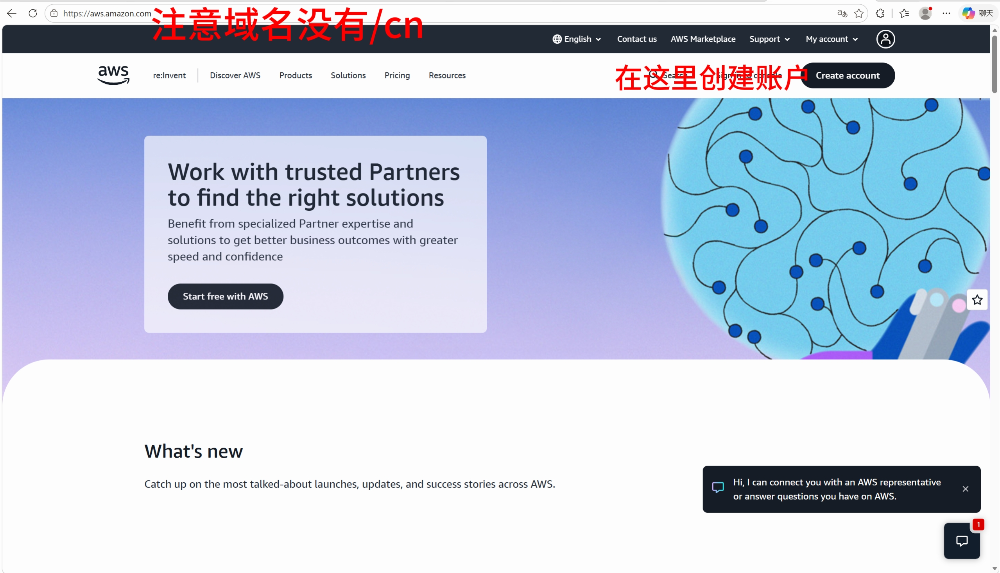
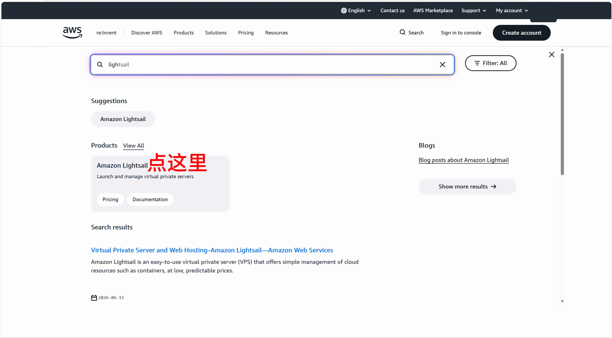
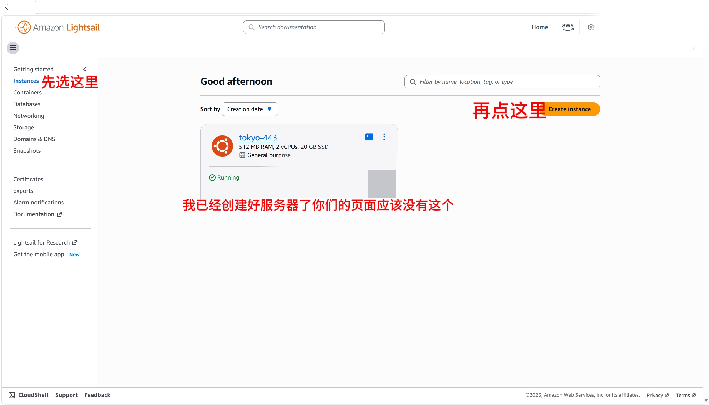
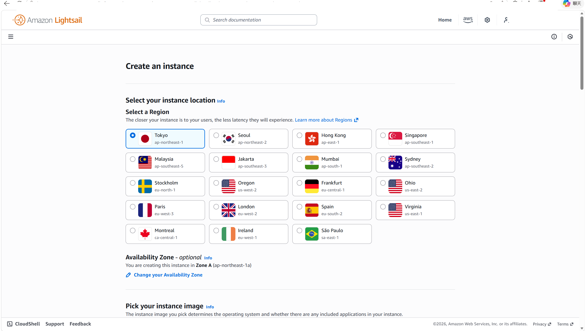
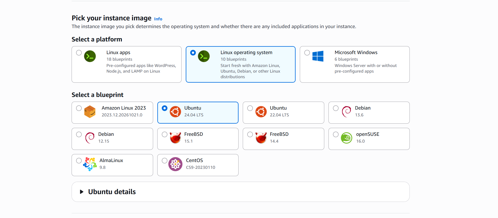
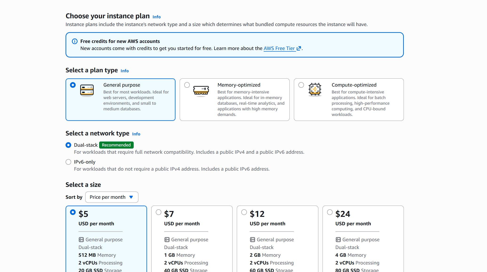
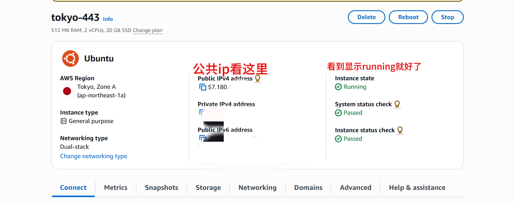
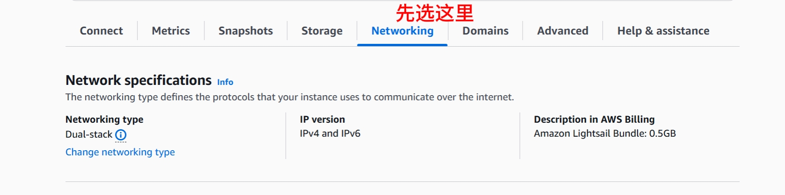
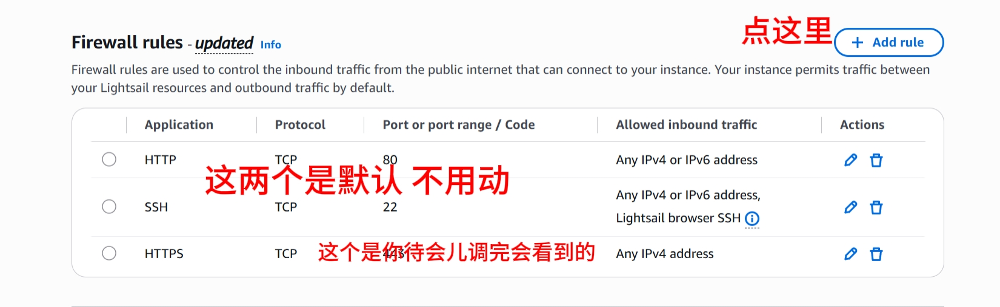
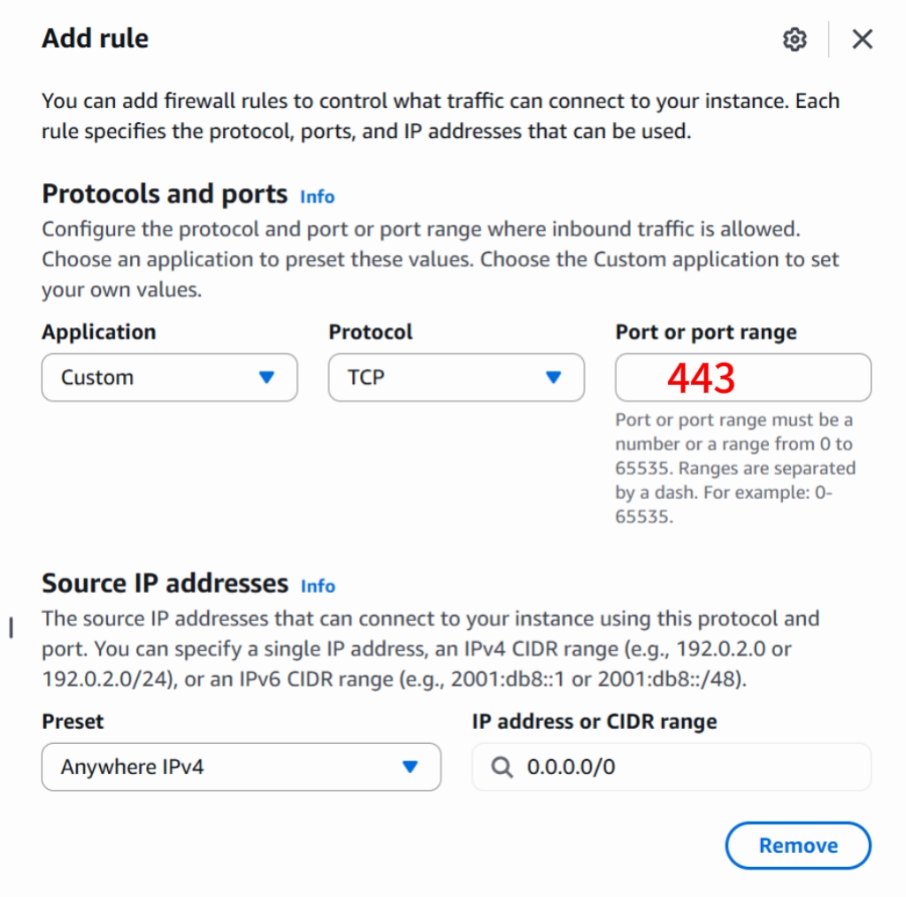

# 第一步：买一台机器（15 分钟）

> **这一节做什么**：在亚马逊云（AWS）上租一台每月 5 美元的电脑。
> **做完你手上会有**：一个 IP 地址、一个密钥文件（`.pem`）。

跟着做，不用理解每一步为什么。

---

## 1. 打开网站

浏览器输入：

```
https://aws.amazon.com
```

点右上角 **Create an AWS Account**（创建账户）。



*图：用橙色按钮开始注册*


> ⚠️ 一定要是 `aws.amazon.com`，不要进 `amazonaws.cn`（那是中国区，个人用不了，还要备案）。

---

## 2. 注册

按提示填：

| 填什么 | 注意 |
|---|---|
| 邮箱 | 常用邮箱，要能收验证码 |
| 密码 | 至少 8 位，含大小写和数字 |
| 账户类型 | 选 **Personal**（个人） |
| 姓名地址 | 填真实信息。国家选 **Singapore** 或 **United States** |
| 信用卡 | 要能付外币。会扣 1 美元验证，之后退回 |

**注册时不要挂代理。** IP 跳来跳去会触发风控审核，反而更慢。

> 卡住的话：如果提示要上传身份证/信用卡照片，按要求传，通常几小时到一天通过。
> 这段时间可以先看 [01-它是怎么回事](01-它是怎么回事.md)。

---

## 3. 进入 Lightsail（不要用 EC2）

注册完成后进控制台，在顶部搜索框输入：

```
Lightsail
```



*图：在搜索框输入 Lightsail，点下拉里的那一条*

点进去。**一定要用 Lightsail**，不要用 EC2——EC2 计费复杂，容易莫名其妙扣钱。

---

## 4. 创建实例

点橙色的 **Create instance**。



*图：右上角的 Create instance；如果你已经建过实例，页面中间会多一个卡片，那是我这边已经建好的*

然后只改三个地方：

### ① 区域（右上角）

选 **Tokyo, Japan (ap-northeast-1)**

> 东京离国内最近，延迟低。不要选香港。

### ② 系统（中间的 Select a blueprint）

- Platform 保持 **Linux/Unix**
- 切到 **OS Only** 标签
- 点 **Ubuntu 24.04 LTS**



*图：创建实例页面的上半部分，注意 Platform 选 Linux/Unix*



*图：OS Only 标签下选 Ubuntu 24.04 LTS*

### ③ 套餐（往下滚 Choose your instance plan）

选这一行：

```
$5 USD/month
1 GB Memory · 2 vCPUs · 40 GB SSD · 2 TB Transfer
```

> 默认可能停在 $7 或 $12，注意往上调到 $5 那行。



*图：$5 那一行（1 GB / 2 vCPU / 40 GB / 2 TB）*


其他不用动：

- **Automatic snapshots** 不要勾（额外收费）
- Instance name 可以改成 `tokyo-443`（好认）

点最下面橙色的 **Create instance**。

---

## 5. 等它变成 Running

大约 1～2 分钟。刷新页面，状态从 `Pending` 变成 **Running** 就好了。



*图：实例卡片上的 Running 状态；公网 IP 在实例详情页里（图中已打码）*


---

## 6. 开 443 端口（最容易漏的一步⚠️）

点进这个实例，找到 **Networking** 标签页，往下滚动到 **IPv4 Firewall**。



*图：先点 Networking 这个标签*


默认只有一条 `SSH TCP 22`。点 **Add rule**，按下表填：



*图：默认只有 SSH 22 这一条规则*


| 字段 | 填什么 |
|---|---|
| Application | **Custom** |
| Protocol | **TCP** |
| Port | **443** |
| Source IP addresses | Preset 选 **Anywhere (IPv4)**，或直接输入 `0.0.0.0/0` |

点 **Add rule** 保存。



*图：按这个填——Custom / TCP / 443 / Anywhere (IPv4)*


最后应该看到两条：

```
SSH          TCP   22      ← 默认的，别删
Custom       TCP   443     ← 你刚加的
```

> **为什么这步不能漏**：不开这个端口，后面所有步骤都会显示"连不上"，
> 而错误信息完全不会提示你是端口没开。这是新手 90% 卡住的地方。

---

## 7. 抄下 IP 地址

还在实例页面，找到 **Public IPv4 address**，长这样：

```
203.0.113.45
```

**记下来**。这就是你以后要用的地址。

---

## 8. 下载密钥文件

1. 点右上角你的头像
2. 选 **Account**
3. 左边菜单找到 **SSH keys**
4. 找到 `Default key`，点 **Download**

下载下来是一个 `.pem` 文件，比如 `LightsailDefaultKey-ap-northeast-1.pem`。

**把它放在一个你记得住的文件夹**，比如 `C:\Users\你的用户名\Lightsail\`。

> 这个文件等于你服务器的钥匙。丢了只能重新下载或重建实例，别乱删。

---

---

## 9. 注册完立刻做三件事（安全）

你注册出来的账号叫 **root 用户**——最高权限，没有之一。
它能开机器、能删数据、能改付款方式。**每个 AWS 账号都是这样注册的**，不是你操作错了。

但它有两个风险：账号被盗 = 别人的账单寄给你；误操作 = 把机器删了。

所以花 5 分钟做这三件事：

### ① 开两步验证（最重要）

1. 右上角头像 → **Security credentials**
2. 找到 **Multi-factor authentication (MFA)** → **Assign MFA device**
3. 设备名随便填（比如 `phone`），选 **Authenticator app**
4. 手机装一个验证器（Google Authenticator / Microsoft Authenticator / Authy 都行）
5. 扫屏幕上的二维码，把手机显示的 6 位数字填回网页（要填两次）

以后登录除了密码，还要输手机上那 6 位数字。

### ② 确认没有 root 的"访问密钥"

还在 **Security credentials** 页面，往下找 **Access keys**。

**正常情况下这里应该是空的。** 如果有，说明你（或某个教程）给 root 建过密钥——
点 **Delete** 删掉。日常操作不需要它，留着反而是风险。

### ③ 设一个账单告警（防意外扣费）

1. 顶部搜索框输入 **Budgets** → 进入 **AWS Budgets**
2. **Create budget** → 选 **Zero-Spend budget**（或自定义 $10）
3. 填你的邮箱，保存

花超了会发邮件提醒你。这一步救过很多人——包括忘记关机的人。

---

> 进阶做法（可选）：日常管理另建一个 IAM 用户，root 只在必要时用。
> 对这套教程来说不必要——你只用 Lightsail 点几下，root 足够，把 MFA 开了就行。

## ✅ 检查点

做完这一节，你手上应该有：

- [ ] 一个 IP 地址（形如 `203.0.113.45`）
- [ ] 一个 `.pem` 文件，放在你知道的路径
- [ ] AWS 实例显示 **Running**
- [ ] 防火墙里有 `Custom TCP 443`

四条都齐了，进入下一步。

---

## 这一步常见问题

**找不到 Lightsail 入口？**
顶部搜索框直接打字搜索 `Lightsail`，别在菜单里翻。

**注册被拒/要求验证？**
AWS 对新账户有风控。不要挂代理重试，按邮件要求验证即可。

**找不到 $5 套餐？**
套餐列表要往下滚，"General purpose" 下面第一行才是 $5。

**怕忘记关掉被扣钱？**
在手机上设个提醒：**每月检查一次**。不想用了就去控制台 **Terminate（删除）** 实例，
只是 Stop（关机）照样收费。

---

下一页：[03-第二步-让机器开始工作](03-第二步-让机器开始工作.md)
