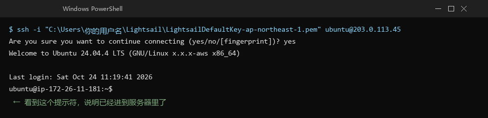
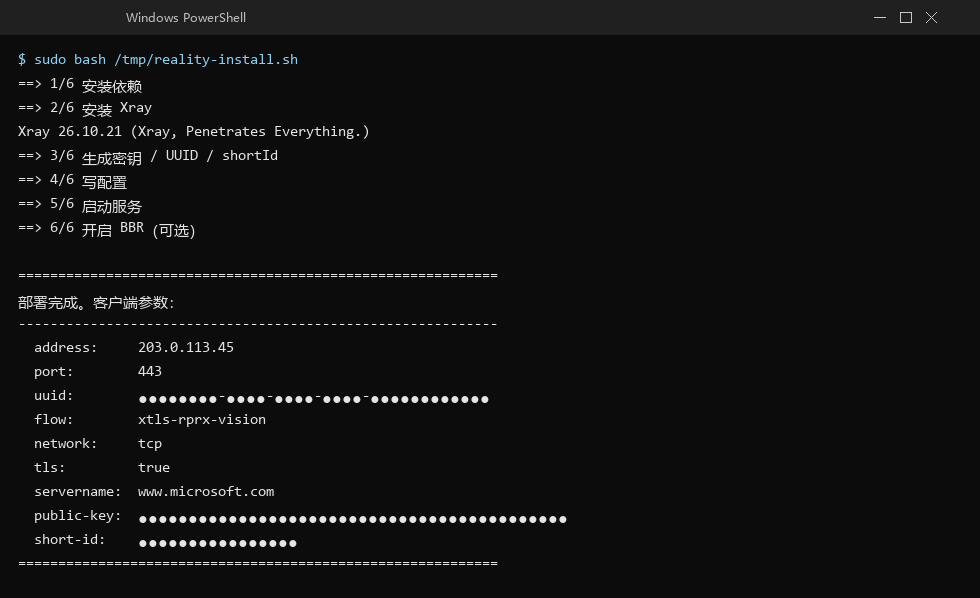

# 第二步：让机器开始工作（10 分钟）

> **这一节做什么**：登录服务器，跑一条命令，把服务装好。
> **做完你手上会有**：三个参数（UUID、公钥、shortId），客户端配置要用。

全程就是**复制、粘贴、回车**。你不用理解命令在干什么。

---

## 1. 打开 PowerShell

按 `Win + X`，选 **Windows PowerShell**（或"终端"）。

会打开一个蓝底/黑底的窗口，光标闪啊闪——这就是命令行。

---

## 2. 修一下密钥文件权限（必须做，否则连不上）

Windows 默认会给密钥文件"太宽的权限"，SSH 会拒绝使用它。先修：

```powershell
icacls "C:\Users\你的用户名\Lightsail\LightsailDefaultKey-ap-northeast-1.pem" /inheritance:r /grant:r "$env:USERNAME:R"
```

**把路径换成你自己的**（就是你下载 `.pem` 的地方）。

正常会显示 `已处理 1 个文件`。

---

## 3. 连上服务器

```powershell
ssh -i "C:\Users\你的用户名\Lightsail\LightsailDefaultKey-ap-northeast-1.pem" ubuntu@你的IP
```

比如：

```powershell
ssh -i "C:\Users\你的用户名\Lightsail\LightsailDefaultKey-ap-northeast-1.pem" ubuntu@203.0.113.45
```

**第一次连会问一句**：

```
Are you sure you want to continue connecting (yes/no/[fingerprint])?
```

输入 `yes` 回车（要打全三个字母，不能只打 y）。

**成功的样子**：

```
ubuntu@ip-172-26-11-181:~$
```



*图：连上服务器后的提示符（示意，实际窗口样式略有差异）*

看到这个提示符，说明你已经进到那台服务器里面了。
**之后所有命令都在这个窗口里敲。**

> 提示：这个窗口现在代表"那台外国电脑"，不是你的电脑了。要回到自己电脑，
> 敲 `exit` 或者直接关窗口。

---

## 4. 把安装脚本传上去

**新开一个** PowerShell 窗口（原来那个别关，还连着服务器），执行：

```powershell
scp -i "C:\Users\你的用户名\Lightsail\LightsailDefaultKey-ap-northeast-1.pem" "脚本所在路径\reality-install.sh" ubuntu@你的IP:/tmp/
```

脚本就在这个仓库的 `scripts/reality-install.sh`。

> 如果 `scp` 报错找不到命令，说明你的 Windows 版本较老。改用网页终端：
> Lightsail 实例页面右上角有个 **Connect using SSH** 按钮，点开就是浏览器里的终端，
> 然后手动创建文件（这一步比较麻烦，建议先用 scp 试试）。

---

## 5. 跑安装脚本

回到**连着服务器那个窗口**，执行：

```bash
sudo bash /tmp/reality-install.sh
```

然后等 1～2 分钟。屏幕会滚过一堆文字，这是正常安装。

**最后会打印出这样一个方框**：

```
============================================================
部署完成。客户端参数：
------------------------------------------------------------
  address:     203.0.113.45
  port:        443
  uuid:        11111111-1111-4111-8111-111111111111
  flow:        xtls-rprx-vision
  network:     tcp
  tls:         true
  servername:  www.microsoft.com
  public-key:  AAAAAAAAAAAAAAAAAAAAAAAAAAAAAAAAAAAAAAAAAAA
  short-id:    0123456789abcdef
...
```



*图：脚本跑完后会打印这样一个方框，其中三行密钥已经打码（示意）*

### 📌 把这三行抄下来

```
UUID:        ______________________
public-key:  ______________________
short-id:    ______________________
```

**这就是你的钥匙**，下一步要用。存在备忘录里，别发群里。

---

## 6. 检查服务是不是真的跑起来了

在服务器窗口里执行：

```bash
sudo ss -ltnp | grep 443
```

**正常应该看到一行**，里面有 `:443` 和 `xray`：

```
LISTEN 0 4096 0.0.0.0:443 0.0.0.0:* users:(("xray",pid=1234,fd=3))
```

如果什么都没输出——说明没跑起来，去看 [06-出问题了怎么办](06-出问题了怎么办.md) 的第 1 条。

---

## ✅ 检查点

- [ ] 服务器窗口提示符是 `ubuntu@ip-...:~$`
- [ ] 安装脚本打印了参数方框
- [ ] 抄下了 UUID / public-key / short-id
- [ ] `ss -ltnp | grep 443` 能看到 xray

---

## 这一步常见问题

**`Permission denied (publickey)`**
密钥权限没修好，回到第 2 步重做一次 icacls。

**`Connection timed out`**
22 端口不通。检查实例是否 Running、防火墙里有 SSH 22。

**`scp: command not found`**
用 Lightsail 网页版终端（实例页右上角 Connect using SSH）。

**安装脚本跑了一半就退回提示符，没打印参数**
说明脚本中途失败了。这条命令可以看原因：

```bash
sudo journalctl -u xray -n 30 --no-pager
```

把输出发给 AI，或者对照 [06](06-出问题了怎么办.md) 第 5 条。

---

**下一步，按你的电脑系统选一篇：**

- Windows → [04a-第三步-让电脑用上它-Windows](04a-第三步-让电脑用上它-Windows.md)
- macOS → [04b-第三步-让电脑用上它-macOS](04b-第三步-让电脑用上它-macOS.md)
