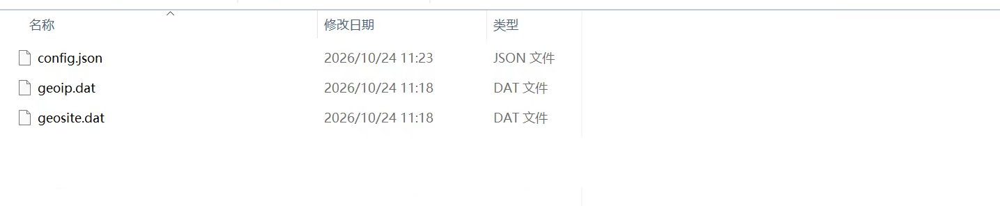
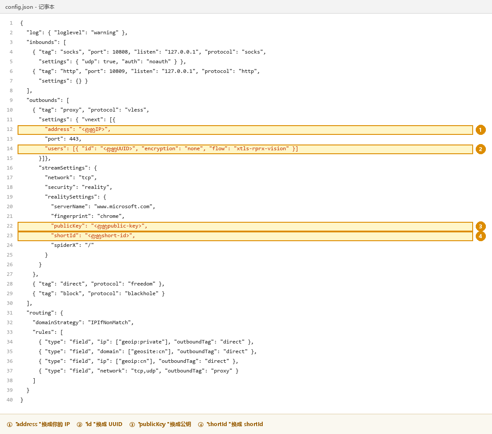
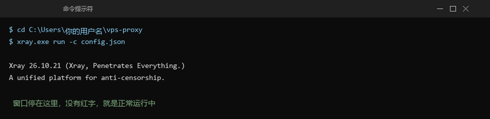
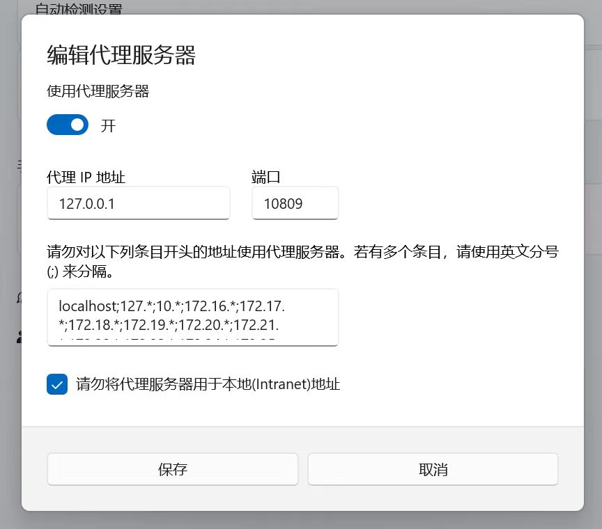

# 第三步（Windows）：让电脑用上它

> **这一节做什么**：在 Windows 上装一个小程序，让它替你转发"出国的流量"。
> **做完你手上会有**：一台能正常打开 GitHub / ChatGPT 的电脑。

---

## 1. 下载一个小程序

打开这个链接，会自动下载一个 15MB 的压缩包：

```
https://github.com/XTLS/Xray-core/releases/latest/download/Xray-windows-64.zip
```

如果打不开（可能因为你现在还上不了 GitHub），用手机热点下载再传到电脑，
或者让朋友发你一份。

---

## 2. 解压到一个固定位置

解压后你会看到一堆文件，把**全部**放到这个文件夹：

```
C:\Users\你的用户名\vps-proxy\
```

里面至少要有：

```
xray.exe
geoip.dat
geosite.dat
```


*图：文件夹里至少有这三个文件（config.json 是下一步新建的；图中另一行已涂掉）*


> 这三个必须在同一个文件夹里，少一个都不能用。

---

## 3. 新建配置文件

在同一个文件夹里，新建一个文本文件，命名为 `config.json`。

> ⚠️ 注意：Windows 默认隐藏文件后缀，你可能建成 `config.json.txt`。
> 解决：文件夹上方「查看」→ 勾选「文件扩展名」，再确认文件名是 `config.json`。

用记事本打开它，把下面整段复制进去：

```json
{
  "log": { "loglevel": "warning" },
  "inbounds": [
    { "tag": "socks", "port": 10808, "listen": "127.0.0.1", "protocol": "socks",
      "settings": { "udp": true, "auth": "noauth" } },
    { "tag": "http", "port": 10809, "listen": "127.0.0.1", "protocol": "http",
      "settings": {} }
  ],
  "outbounds": [
    { "tag": "proxy", "protocol": "vless",
      "settings": { "vnext": [{
        "address": "改成你的IP",
        "port": 443,
        "users": [{ "id": "改成你的UUID", "encryption": "none", "flow": "xtls-rprx-vision" }]
      }]},
      "streamSettings": {
        "network": "tcp",
        "security": "reality",
        "realitySettings": {
          "serverName": "www.microsoft.com",
          "fingerprint": "chrome",
          "publicKey": "改成你的public-key",
          "shortId": "改成你的short-id",
          "spiderX": "/"
        }
      }
    },
    { "tag": "direct", "protocol": "freedom" },
    { "tag": "block", "protocol": "blackhole" }
  ],
  "routing": {
    "domainStrategy": "IPIfNonMatch",
    "rules": [
      { "type": "field", "ip": ["geoip:private"], "outboundTag": "direct" },
      { "type": "field", "domain": ["geosite:cn"], "outboundTag": "direct" },
      { "type": "field", "ip": ["geoip:cn"], "outboundTag": "direct" },
      { "type": "field", "network": "tcp,udp", "outboundTag": "proxy" }
    ]
  }
}
```

### 只改三个地方

| 找这一行 | 改成 |
|---|---|
| `"address": "改成你的IP"` | 引号里换成你的 IP，例如 `"203.0.113.45"` |
| `"id": "改成你的UUID"` | 换成第二步抄的 UUID |
| `"publicKey": "改成你的public-key"` | 换成第二步抄的公钥 |
| `"shortId": "改成你的short-id"` | 换成第二步抄的 shortId |

> 一共四处（IP + 三个密钥）。**引号要留着，只换引号里面的内容**。
> 改完保存。



*图：只需要改这四处，其余一个字都不要动（截图来自模板，实际值会被你的替换掉）*

保存前的自检：整段里**不能出现中文**（"改成你的IP"这种必须全部替换掉）。

---

## 4. 启动它

在这个文件夹里，地址栏输入 `cmd` 回车（会打开一个命令行窗口，路径就在当前文件夹）。

然后输入：

```cmd
xray.exe run -c config.json
```

**正常的样子**：屏幕停在那里，不报错，也不退出。

```
Xray 26.x.x (Xray, Penetrates Everything.)
...
```



*图：正常运行的样子——窗口停住、没有红字（示意）*

> 如果窗口一闪就消失，或者刷出红字，说明 config.json 写错了。
> 把报错截图发给 AI，或者看 [06](06-出问题了怎么办.md) 第 7 条。

**这个窗口不要关**，关了代理就停了。

---

## 5. 告诉 Windows "走这个代理"

**方法一（图形界面，推荐给不熟悉命令的人）**

1. 按 `Win + I` 打开设置
2. 网络和 Internet → 代理
3. 打开「使用代理服务器」，填：

```
地址：127.0.0.1
端口：10809
```

4. 点保存


*图：Windows 的代理设置，填 127.0.0.1 和 10809，开关打开*


**方法二（一条命令）**

在刚才那个 cmd 窗口里（新开一个也行）输入：

```cmd
reg add "HKCU\Software\Microsoft\Windows\CurrentVersion\Internet Settings" /v ProxyServer /d 127.0.0.1:10809 /f
reg add "HKCU\Software\Microsoft\Windows\CurrentVersion\Internet Settings" /v ProxyEnable /t REG_DWORD /d 1 /f
```

---

## 6. 验证

打开浏览器，访问：

```
https://ipify.org
```

- 显示你的 VPS IP（比如 `203.0.113.45`）→ ✅ 成功了
- 还是你家的 IP → 代理没生效，**完全退出浏览器再打开**（重要：不是刷新，是关掉重开）

再试两个：

| 打开 | 应该 |
|---|---|
| github.com | 正常显示 |
| bilibili.com | 正常显示，速度不变（国内直连） |

---

## 7. （可选）让它开机自动运行

不做也能用，只是每次开机要手动启动一次。如果你嫌麻烦：

**① 让程序随系统启动**

在 PowerShell（**管理员身份**）里执行：

```powershell
schtasks /Create /F /TN VPS-Proxy /SC ONSTART /RU SYSTEM /RL HIGHEST /TR "\"C:\Users\你的用户名\vps-proxy\xray.exe\" run -c \"C:\Users\你的用户名\vps-proxy\config.json\""
schtasks /Run /TN VPS-Proxy
```

**② 让代理设置随登录生效**

按 `Win + R`，输入：

```
shell:startup
```

会打开启动文件夹。在里面新建一个文本文件，改名 `代理.vbs`，内容：

```vbs
Set sh = CreateObject("WScript.Shell")
base = "HKCU\Software\Microsoft\Windows\CurrentVersion\Internet Settings"
sh.Run "reg add """ & base & """ /v ProxyServer /d 127.0.0.1:10809 /f", 0, True
sh.Run "reg add """ & base & """ /v ProxyEnable /t REG_DWORD /d 1 /f", 0, True
```

以后开机什么都不用做。

---

## ✅ 检查点

- [ ] `vps-proxy` 文件夹里有 xray.exe、geoip.dat、geosite.dat、config.json
- [ ] cmd 窗口里程序在跑，没报错
- [ ] 浏览器打开 ipify.org 显示的是 VPS 的 IP
- [ ] B 站能正常打开

---

## 常见问题

**ipify 显示的还是我家 IP**
- 浏览器没重启（必须完全退出再开）
- 或者第 5 步没点保存

**所有网站都打不开了**
- 说明代理设了但程序没在跑。检查那个 cmd 窗口是不是关了

**B 站变慢了**
- config.json 里的 `routing` 那段被改坏了，重新复制一份完整的

---

下一页：[05-第四步-手机（iOS / Android）](05-第四步-手机-iOS与Android.md)
