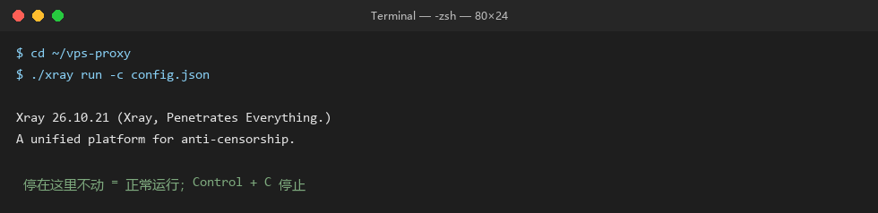

# 第三步（macOS）：让 Mac 用上它

> **这一节做什么**：在 Mac 上装一个小程序，让它替你转发"出国的流量"。
> **做完你手上会有**：一台能正常打开 GitHub / ChatGPT 的 Mac。
>
> 前提：你已经做完 [02-买机器](02-第一步-买一台机器.md) 和 [03-让机器开始工作](03-第二步-让机器开始工作.md)，
> 手上有一个 IP、一个 UUID、一个 public-key、一个 short-id。

---

## 0. 先确认你的 Mac 是哪一种

点左上角  → **关于本机**，看「芯片」那一行：

| 显示 | 你用的是 | 待会下载 |
|---|---|---|
| Apple M1 / M2 / M3 / M4 | Apple 芯片 | `Xray-macos-arm64-v8a.zip` |
| Intel Core i5 / i7 / i9 | Intel 芯片 | `Xray-macos-64.zip` |

> 不用记，下一步两个链接都给你，选一个就好。

---

## 1. 下载并解压

**Apple 芯片（M 系列）**：

```
https://github.com/XTLS/Xray-core/releases/latest/download/Xray-macos-arm64-v8a.zip
```

**Intel 芯片**：

```
https://github.com/XTLS/Xray-core/releases/latest/download/Xray-macos-64.zip
```

下载后双击解压，会得到一个文件夹，里面有一个叫 `xray` 的文件。

---

## 2. 放到固定位置

打开「终端」（启动台搜 `终端`，或者 `Command + 空格` 输入 `terminal`）。

把下面三行**整段**复制进去，回车：

```bash
mkdir -p ~/vps-proxy
mv ~/Downloads/xray ~/vps-proxy/       # 如果解压后不叫 xray，把这里换成实际文件名
ls -l ~/vps-proxy/
```

> 如果提示 `No such file`，说明文件名不对。在访达里看一下解压出来的文件叫什么，
> 把上面 `mv` 那行的 `xray` 换成它。

---

## 3. 允许它运行（macOS 会拦一次）

macOS 默认不允许运行"来路不明"的程序。第一次会被拦，两种解法：

**方法一（简单）**：在访达里找到 `~/vps-proxy/xray`，**右键 → 打开 → 再点「打开」**

**方法二（命令行）**：

```bash
xattr -dr com.apple.quarantine ~/vps-proxy/xray
chmod +x ~/vps-proxy/xray
```

> 只做一次，以后不会再问。

---

## 4. 写配置文件

在终端里执行这一条，会用编辑器打开一个新文件：

```bash
nano ~/vps-proxy/config.json
```

把下面整段粘贴进去（`Command + V`）：

```json
{
  "log": { "loglevel": "warning" },
  "inbounds": [
    { "tag": "socks", "port": 10808, "listen": "127.0.0.1", "protocol": "socks",
      "settings": { "udp": true, "auth": "noauth" } },
    { "tag": "http", "port": 10809, "listen": "127.0.0.1", "protocol": "http",
      "settings": {} }
  ],
  "outbounds": [
    { "tag": "proxy", "protocol": "vless",
      "settings": { "vnext": [{
        "address": "改成你的IP",
        "port": 443,
        "users": [{ "id": "改成你的UUID", "encryption": "none", "flow": "xtls-rprx-vision" }]
      }]},
      "streamSettings": {
        "network": "tcp",
        "security": "reality",
        "realitySettings": {
          "serverName": "www.microsoft.com",
          "fingerprint": "chrome",
          "publicKey": "改成你的public-key",
          "shortId": "改成你的short-id",
          "spiderX": "/"
        }
      }
    },
    { "tag": "direct", "protocol": "freedom" },
    { "tag": "block", "protocol": "blackhole" }
  ],
  "routing": {
    "domainStrategy": "IPIfNonMatch",
    "rules": [
      { "type": "field", "ip": ["geoip:private"], "outboundTag": "direct" },
      { "type": "field", "domain": ["geosite:cn"], "outboundTag": "direct" },
      { "type": "field", "ip": ["geoip:cn"], "outboundTag": "direct" },
      { "type": "field", "network": "tcp,udp", "outboundTag": "proxy" }
    ]
  }
}
```

### 改四处

| 找这一行 | 换成 |
|---|---|
| `"address": "改成你的IP"` | 你的 IP，如 `"203.0.113.45"` |
| `"id": "改成你的UUID"` | 第二步抄的 UUID |
| `"publicKey": "改成你的public-key"` | 第二步抄的公钥 |
| `"shortId": "改成你的short-id"` | 第二步抄的 shortId |

**引号要留着，只换引号里面的内容。整段里不能剩任何中文。**

保存：`Control + O` → 回车 → `Control + X` 退出。

> 检查一下有没有写错：
>
> ```bash
> cat ~/vps-proxy/config.json | grep 改成
> ```
>
> 如果还有输出，说明没改干净。

---

## 5. 启动

```bash
cd ~/vps-proxy
./xray run -c config.json
```



*图：终端里正常运行的样子（示意）*

**正常的样子**：屏幕停住，没有红字，也不退出。

> 这个终端窗口**不要关**，关了代理就停了。
> 想干别的，新建一个终端窗口（`Command + T`）。

按 `Control + C` 可以停止。

---

## 6. 把系统代理指过去

macOS 的图形界面路径（不同版本略有差异）：

```
系统设置 → 网络 → 选中 Wi-Fi（或以太网）→ 详细信息 → 代理
```

打开这两个，都填 `127.0.0.1` / `10809`：

- **网页代理（HTTP）**
- **安全网页代理（HTTPS）**

点「好」，再点「应用」。

**或者用命令行（一条搞定，推荐）**：

```bash
networksetup -setwebproxy "Wi-Fi" 127.0.0.1 10809
networksetup -setsecurewebproxy "Wi-Fi" 127.0.0.1 10809
```

> 如果你用的是有线网络，把 `"Wi-Fi"` 换成 `"Ethernet"`。
> 不确定叫什么名字，先执行 `networksetup -listallnetworkservices` 看列表。

---

## 7. 验证

打开浏览器，访问：

```
https://ipify.org
```

- 显示你的 VPS IP → ✅ 成功
- 还是你原来的 IP → **完全退出浏览器（Command + Q）再打开**

再试：

| 打开 | 应该 |
|---|---|
| github.com | 正常 |
| bilibili.com | 正常且不卡（国内直连） |

---

## 8. 取消代理（不想用的时候）

```bash
networksetup -setwebproxystate "Wi-Fi" off
networksetup -setsecurewebproxystate "Wi-Fi" off
```

或者在「系统设置 → 网络 → 代理」里关掉那两个开关。

---

## 9.（可选）开机自动运行

macOS 不用"计划任务"，用 `LaunchAgent`。

**第一步**：先确认 xray 和配置都在 `~/vps-proxy`，然后执行：

```bash
cat > ~/Library/LaunchAgents/com.local.xray.plist <<'EOF'
<?xml version="1.0" encoding="UTF-8"?>
<!DOCTYPE plist PUBLIC "-//Apple//DTD PLIST 1.0//EN" "http://www.apple.com/DTDs/PropertyList-1.0.dtd">
<plist version="1.0">
<dict>
  <key>Label</key><string>com.local.xray</string>
  <key>ProgramArguments</key>
  <array>
    <string>/Users/你的用户名/vps-proxy/xray</string>
    <string>run</string>
    <string>-c</string>
    <string>/Users/你的用户名/vps-proxy/config.json</string>
  </array>
  <key>RunAtLoad</key><true/>
  <key>KeepAlive</key><true/>
  <key>StandardOutPath</key><string>/tmp/xray.log</string>
  <key>StandardErrorPath</key><string>/tmp/xray.err</string>
</dict>
</plist>
EOF
```

⚠️ 把里面两处 `/Users/你的用户名/` 改成真实路径（`echo $HOME` 可以看）。

**第二步**：载入

```bash
launchctl unload ~/Library/LaunchAgents/com.local.xray.plist 2>/dev/null
launchctl load ~/Library/LaunchAgents/com.local.xray.plist
```

**第三步**：系统代理每次开机还要重设一次，可以加一条登录项：

```
系统设置 → 通用 → 登录项 → 添加 → 新建一个「运行脚本」的快捷指令
```

或者干脆每次开机手动执行第 6 步那两行 `networksetup` 命令。

> 嫌麻烦的话，**不做自启也完全没问题**：用的时候开终端跑一下，
> 不用了 `Control + C`。很多人就是这么用的。

---

## 常见问题

**提示「无法打开，因为 Apple 无法检查它是否包含恶意软件」**
右键 → 打开 → 再点「打开」。或者跑第 3 步的 `xattr` 命令。

**`command not found: ./xray`**
没在 `vps-proxy` 目录里。先 `cd ~/vps-proxy` 再执行。

**`Permission denied`**
`chmod +x ~/vps-proxy/xray`。

**启动报 JSON 错误**
配置里有中文没替换干净，或者少了个逗号。用 `cat ~/vps-proxy/config.json` 检查。

**浏览器还是连不上**
1. 代理开关有没有打开（系统设置 → 网络 → 代理）
2. 浏览器有没有完全退出重开（Command + Q，不是关窗口）
3. `curl -x http://127.0.0.1:10809 https://api.ipify.org` 在终端里测一下，
   如果这条通，说明是浏览器的问题，不是线路的问题。

**Chrome 装了 SwitchyOmega 之类的扩展**
扩展会覆盖系统代理设置，两边不一致就会互相打架。先在扩展里选「系统代理」。

---

## 和 Windows 版的区别

| | Windows | macOS |
|---|---|---|
| 程序 | `xray.exe` | `xray`（无后缀） |
| 双击运行 | 有 `.cmd` 入口 | 终端里跑，或做成 `.command` |
| 首次拦截 | 防火墙弹窗 | Gatekeeper（右键打开） |
| 设代理 | 设置 → 网络和 Internet → 代理 | 系统设置 → 网络 → 详细信息 → 代理 |
| 开机自启 | 计划任务 schtasks | LaunchAgent plist |
| 卸载 | 删文件夹 + 删计划任务 | 删文件夹 + `launchctl unload` |

---

下一步：[05-第四步-手机（iOS / Android）](05-第四步-手机-iOS与Android.md)
